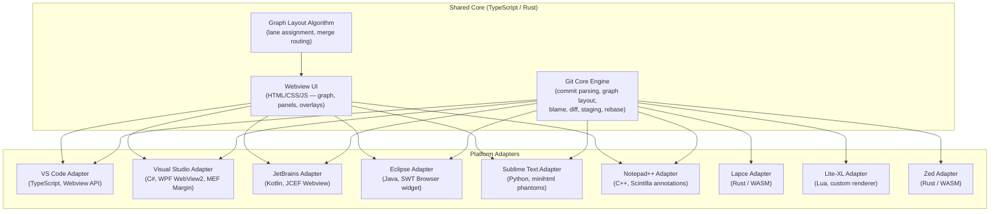

# OmniGit — Universal Git History and Graph Plugin

> A full-featured Git graph visualization + GitLens-style productivity plugin targeting

- **VSCodium** ❤️
- **VS Code**
- **Devin-Desktop**
- **Cursor**
- **Antigravity**
- **Trae**
- **TheiaIDE** (?)
- **Code-OSS**
- **Zed**
- **Lapce**
- **Lite-XL**
- **JetBrains IDEs**
- **Visual Studio**
- **Eclipse**
- **Apache NetBeans**
- **Sublime Text**
- **Notepad++**
- **Webview in web browsers**

Hopefully everywhere will work really fine as expected.

---

## Vision

A single, unified Git experience across all major IDEs — combining the **interactive graph visualization** of Git Graph with the **deep code intelligence** of GitLens.

---

## Architecture: Shared Core + Platform Adapters



### Key Design Decisions

| Decision            | Choice                                                                               | Rationale                                                                     |
| :------------------ | :----------------------------------------------------------------------------------- | :---------------------------------------------------------------------------- |
| **Git interaction** | Shell out to system `git` CLI                                                        | Universal, no library dependency per platform                                 |
| **Graph rendering** | Custom SVG engine in webview                                                         | Portable across all webview hosts; full control                               |
| **Core language**   | TypeScript (compiled to JS for webview)                                              | Shared across VS Code + webview; JetBrains/Eclipse embed via JCEF/SWT Browser |
| **Zed strategy**    | Rust adapter with simplified terminal-based view initially; webview when API matures | Zed's Wasm extensions don't yet support custom UI panels                      |
| **Communication**   | JSON message passing (`postMessage` / stdin-stdout)                                  | Works in all webview sandboxes                                                |

---

## Monorepo Structure

```text
git-plugin/
├── packages/
│   ├── core/                          # Shared git logic (TypeScript)
│   │   ├── src/
│   │   │   ├── git/
│   │   │   │   ├── executor.ts        # Git CLI wrapper
│   │   │   │   ├── log-parser.ts      # Commit log parser
│   │   │   │   ├── blame.ts           # Git blame engine
│   │   │   │   ├── diff.ts            # Diff generation & parsing
│   │   │   │   ├── staging.ts         # Partial add / hunk & line staging
│   │   │   │   ├── stash.ts           # Stash management & stash diffs
│   │   │   │   ├── rebase.ts          # Interactive rebase engine
│   │   │   │   ├── refs.ts            # Branch/tag operations
│   │   │   │   └── types.ts           # Shared type definitions
│   │   │   ├── graph/
│   │   │   │   ├── layout.ts          # Lane assignment algorithm
│   │   │   │   ├── colors.ts          # Branch color palette
│   │   │   │   └── types.ts           # Graph node/edge types
│   │   │   └── index.ts
│   │   ├── test/
│   │   │   ├── log-parser.test.ts     # Log & ref parsing tests
│   │   │   ├── layout.test.ts         # Graph layout & lane tests
│   │   │   ├── diff.test.ts           # Unified diff parsing tests
│   │   │   ├── rebase.test.ts         # Rebase plan formatting tests
│   │   │   └── stash.test.ts          # Stash parser tests
│   │   ├── package.json
│   │   └── tsconfig.json
│   │
│   ├── webview-ui/                     # Shared webview frontend
│   │   ├── src/
│   │   │   ├── components/
│   │   │   │   ├── Graph.ts           # SVG graph renderer
│   │   │   │   ├── CommitRow.ts       # Commit list row & context menu
│   │   │   │   ├── CommitDetail.ts    # Commit detail & comparison panel
│   │   │   │   ├── DiffView.ts        # Split & unified diff + hunk & line staging
│   │   │   │   ├── FileHistory.ts     # File history timeline
│   │   │   │   ├── StashPanel.ts      # Stash management & diff UI
│   │   │   │   ├── RebaseDialog.ts    # Interactive rebase visual modal
│   │   │   │   ├── SearchBar.ts       # Commit search/filter
│   │   │   │   ├── BranchManager.ts   # Branch/tag CRUD
│   │   │   │   └── Contributors.ts    # Contributors view
│   │   │   ├── styles/
│   │   │   │   ├── theme.css          # Host theme variable mappings
│   │   │   │   ├── graph.css          # SVG graph nodes and edges
│   │   │   │   ├── panels.css         # Tab panels & commit details
│   │   │   │   ├── diff.css           # Diff views & staging gutter
│   │   │   │   ├── components.css     # Modals, rebase, tabs, timeline
│   │   │   │   └── animations.css     # Transitions & keyframes
│   │   │   ├── bridge.ts             # Message bridge (Host ↔ Webview + Mock)
│   │   │   └── main.ts
│   │   ├── index.html
│   │   ├── vite.config.ts
│   │   └── package.json
│   │
│   ├── vscode/                        # VS Code extension
│   │   ├── src/
│   │   │   ├── extension.ts           # Activation, command registry
│   │   │   ├── webview-provider.ts    # Webview panel & message handling
│   │   │   ├── blame-decoration.ts    # Inline blame decorations & gutter heatmap
│   │   │   ├── hover-provider.ts      # Hover card with commit details
│   │   │   ├── codelens-provider.ts   # CodeLens for recent authoring
│   │   │   ├── status-bar.ts          # Status bar branch/sync widget
│   │   │   └── commands.ts            # Command handlers
│   │   ├── package.json
│   │   └── tsconfig.json
│   │
│   ├── jetbrains/                     # JetBrains plugin
│   │   ├── src/main/kotlin/
│   │   │   ├── GitGraphToolWindowFactory.kt
│   │   │   ├── GitGraphWebviewPanel.kt  # JCEF webview
│   │   │   ├── BlameAnnotationProvider.kt
│   │   │   ├── GitGraphAction.kt
│   │   │   └── GitBridge.kt            # JS Query bridge
│   │   ├── src/main/resources/
│   │   │   └── META-INF/plugin.xml
│   │   ├── build.gradle.kts
│   │   └── settings.gradle.kts
│   │
│   ├── eclipse/                       # Eclipse plugin
│   │   ├── src/
│   │   │   ├── GitGraphView.java      # ViewPart with SWT Browser
│   │   │   ├── BlameAnnotationModel.java
│   │   │   └── GitBridge.java          # SWT Browser Function bridge
│   │   ├── META-INF/MANIFEST.MF
│   │   ├── plugin.xml
│   │   ├── build.properties
│   │   └── pom.xml
│   │
│   ├── visualstudio/                  # Visual Studio (Community/Pro/Ent 2017/2019/2022+)
│   │   ├── OmniGit.sln
│   │   ├── README.md
│   │   └── OmniGit.VisualStudio/
│   │       ├── OmniGit.VisualStudio.csproj
│   │       ├── source.extension.vsixmanifest
│   │       ├── OmniGitPackage.cs      # AsyncPackage entrypoint & menu commands
│   │       ├── OmniGitPackage.vsct    # Visual Studio Command Table
│   │       ├── ToolWindows/           # WPF tool window hosting WebView2
│   │       ├── Git/                   # C# Git bridge & CLI execution
│   │       └── Editor/                # MEF IWpfTextViewMargin inline blame
│   │
│   ├── sublimetext/                   # Sublime Text 3 & 4 package
│   │   ├── omnigit.py                 # Inline blame phantoms & command handlers
│   │   ├── Default.sublime-commands
│   │   ├── Main.sublime-menu
│   │   ├── Default.sublime-keymap
│   │   └── README.md
│   │
│   ├── notepadplusplus/               # Notepad++ (x64 / x86) native plugin
│   │   ├── NppOmniGit.vcxproj
│   │   ├── src/                       # Scintilla annotations & dockable WebView2
│   │   └── README.md
│   │
│   ├── lapce/                         # Lapce editor extension
│   │   ├── Cargo.toml                 # Rust WASI plugin
│   │   ├── plugin.toml
│   │   ├── src/lib.rs
│   │   └── README.md
│   │
│   ├── litexl/                        # Lite-XL editor plugin
│   │   ├── init.lua                   # Lua plugin with inline renderer blame
│   │   └── README.md
│   │
│   └── zed/                           # Zed extension
│       ├── src/
│       │   └── lib.rs                 # Wasm extension entrypoint
│       ├── extension.toml
│       └── Cargo.toml
│
├── package.json                       # Root workspace config
├── pnpm-workspace.yaml
├── turbo.json                         # Turborepo task orchestration
├── tsconfig.base.json
├── LICENSE
└── README.md
```

---

## Implementation Progress

### Milestone 1: Project Setup & Core Engine ✅

- [x] Monorepo scaffold (`pnpm-workspace.yaml`, `turbo.json`, `tsconfig.base.json`)
- [x] Git CLI executor with buffer & timeout control (`packages/core/src/git/executor.ts`)
- [x] Robust log parser supporting custom delimiters (`packages/core/src/git/log-parser.ts`)
- [x] Graph layout algorithm with topological swimlane assignment (`packages/core/src/graph/layout.ts`)
- [x] Blame engine with line mapping (`packages/core/src/git/blame.ts`)
- [x] Diff parser with unified, numstat, and binary detection (`packages/core/src/git/diff.ts`)
- [x] Stash operations & stash diff parser (`packages/core/src/git/stash.ts`)
- [x] Interactive rebase engine (`packages/core/src/git/rebase.ts`)
- [x] Comprehensive unit tests (`log-parser.test.ts`, `layout.test.ts`, `diff.test.ts`, `rebase.test.ts`, `stash.test.ts`)

### Milestone 2: Graph Visualization & Webview UI ✅

- [x] Custom SVG renderer with bezier curved lane routing (`Graph.ts`)
- [x] Commit row virtualization with right-click context menu (`CommitRow.ts`)
- [x] Commit detail panel with file stats and actions (`CommitDetail.ts`)
- [x] Branch & tag visual pills and color palettes (`colors.ts`, `theme.css`)
- [x] Search & filter bar by commit message, hash, and author (`SearchBar.ts`)
- [x] Branch manager with checkout, create, and delete (`BranchManager.ts`)
- [x] Stash panel with save, apply, pop, drop, and diff inspection (`StashPanel.ts`)
- [x] Visual interactive rebase modal with drag/drop/reorder & action selects (`RebaseDialog.ts`)
- [x] Side-by-side & unified diff viewer with file, hunk, and line staging (`DiffView.ts`)
- [x] Contributors view with commit breakdown bars (`Contributors.ts`)
- [x] Standalone dev mode with full mock data (`bridge.ts`)

### Milestone 3: GitLens Code Intelligence Features (VS Code) ✅

- [x] Inline blame annotations with gutter commit heatmap (`blame-decoration.ts`)
- [x] Rich hover provider with commit details and clickable actions (`hover-provider.ts`)
- [x] CodeLens provider showing recent author counts and change recency (`codelens-provider.ts`)
- [x] Status bar item with branch name and sync indicator (`status-bar.ts`)
- [x] File history timeline with click-to-diff (`FileHistory.ts`)
- [x] Full command palette integration (`commands.ts`, `package.json`)

### Milestone 4: Advanced Git Operations ✅

- [x] Partial staging UI: whole-file staging, hunk staging, and line staging (`staging.ts`, `DiffView.ts`)
- [x] Stash inspection: click any stash to inspect patch diff (`stash.ts`, `StashPanel.ts`)
- [x] Visual interactive rebase: reorder, pick, reword, edit, squash, fixup, drop (`rebase.ts`, `RebaseDialog.ts`)
- [x] Commit comparison: side-by-side comparison between any two commits or branches (`CommitDetail.ts`, `main.ts`)

### Milestone 5: Multi-IDE Expansion ✅

- [x] **JetBrains Plugin**:
  - `build.gradle.kts`, `settings.gradle.kts`, `plugin.xml`
  - `GitGraphToolWindowFactory.kt` and `GitGraphWebviewPanel.kt` (JCEF browser with JS query bridge)
  - `GitBridge.kt` and `GitGraphAction.kt`
  - `BlameAnnotationProvider.kt`
- [x] **Eclipse Plugin**:
  - `pom.xml` (Tycho Maven build), `META-INF/MANIFEST.MF`, `plugin.xml`, `build.properties`
  - `GitGraphView.java` (SWT Browser with `__eclipseBridge` function)
  - `GitBridge.java` and `BlameAnnotationModel.java`
- [x] **Visual Studio Extension (Community & Upward — 2017, 2019, 2022+)**:
  - `OmniGit.sln` and `OmniGit.VisualStudio.csproj` targeting .NET Framework 4.7.2/4.8
  - `source.extension.vsixmanifest` targeting x86 (VS 2017 & 2019) and amd64 (VS 2022)
  - `OmniGitPackage.cs` & `OmniGitPackage.vsct` (`Ctrl+Alt+G` and View menu integration)
  - `GitGraphToolWindow.cs` & `GitGraphToolWindowControl.xaml/.cs` with Microsoft WebView2
  - `GitBridge.cs` asynchronous Git CLI bridge supporting commit logs, status, branches, tags, stashes, and diffs
  - `BlameMargin.cs` & `BlameMarginFactory.cs` (MEF `IWpfTextViewMargin` inline Git blame margin)
- [x] **Sublime Text Package (3 & 4)**:
  - `omnigit.py` with `minihtml` inline blame phantoms
  - `Default.sublime-commands`, `Main.sublime-menu`, and `Default.sublime-keymap` (`Ctrl+Alt+G`)
- [x] **Notepad++ Plugin (x64 / x86)**:
  - `NppOmniGit.vcxproj`, `PluginDefinition.cpp`, `OmniGitPlugin.cpp`
  - Scintilla `SCI_ANNOTATIONSETTEXT` line blame annotations & dockable WebView2 container
- [x] **Zed Extension**:
  - `Cargo.toml`, `extension.toml`, `src/lib.rs`
- [x] **Lapce Extension**:
  - `Cargo.toml`, `plugin.toml`, `src/lib.rs` (Rust/WASI plugin registering Git Graph & blame)
- [x] **Lite-XL Plugin**:
  - `init.lua` with custom renderer inline blame, commands, and keymaps
